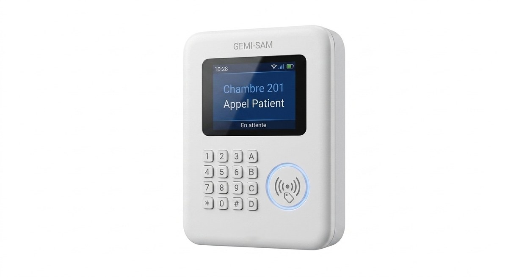
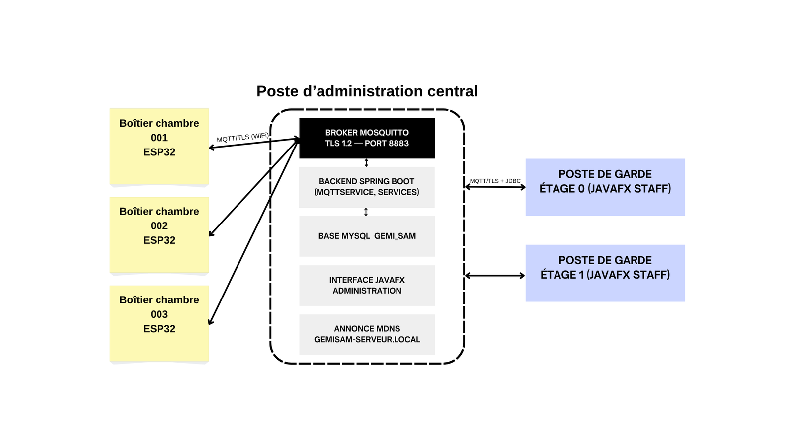
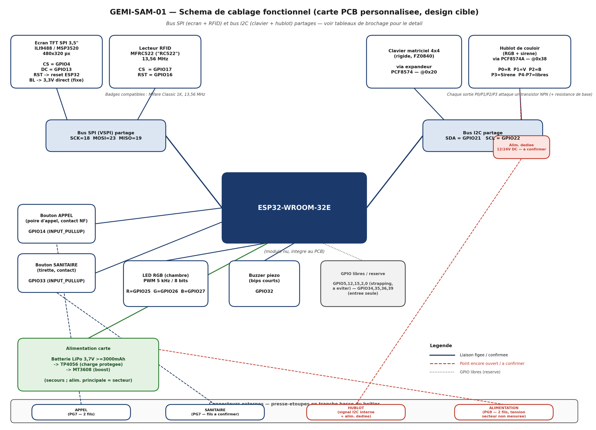

# GEMI-SAM-01 — Firmware ESP32 (boîtier de chambre)

<p align="center">
  
</p>

Voici le firmware du boîtier installé dans chaque chambre du **système d'appel malade sans fil GEMI-SAM-01**.

J'ai conçu et développé ce système pendant mon stage au bureau d'études de **GEMI** (2026), dans le cadre de ma formation d'ingénieure en génie biomédical à l'ISTMT – Université de Tunis El Manar.

> 🔗 Ce dépôt est **une des deux parties** du projet. L'application de supervision (serveur + écrans des soignants) se trouve dans **[gemi-sam-dashboard](https://github.com/henichahd/gemi-sam-dashboard)**.

---

## 🏗️ Architecture du système

<p align="center">
  
</p>

Chaque boîtier envoie l'état de sa chambre au poste central par **MQTT sur TLS**. Il reçoit en retour les décisions du serveur : vérification des PIN, liste des badges autorisés et accusés de réception.

---

## 📋 Fonctionnalités

- **Appel patient** et **appel sanitaire** par boutons physiques
- **Urgence discrète** : touches **A + D** maintenues 1 s sur le clavier
- **Authentification du soignant** par badge RFID (RC522) ou code PIN individuel vérifié par le serveur
- **Machine à états (FSM)** à 9 états :
  `IDLE`, `APPEL`, `SANITAIRE`, `ATTENTE_AUTH_URGENCE`, `URGENCE`,
  `PRIS_EN_CHARGE_INFIRMIER`, `PRIS_EN_CHARGE_MEDECIN`, `CLOTURE`, `SAFE_MODE`
- **Escalade** de l'alerte sonore sans réponse (référence NF S90-500)
- **Heartbeat** toutes les 10 s : défaut de liaison détecté en 30 s au plus (DIN VDE 0834)
- **File d'attente en mémoire NVS** : les alertes sont conservées si le réseau est coupé
- **Portail de configuration WiFi** (`GEMISAM-CONFIG`) : WiFi et numéro de chambre réglés depuis un téléphone, sans reflasher
- **Découverte du serveur par mDNS** (`gemisam-serveur.local`), avec une IP de secours
- **Watchdog** (5 s) et détection des boucles de redémarrage

---

## 📦 Le boîtier

J'ai modélisé le boîtier sous **SolidWorks** (128 × 174 × 50 mm). Le rendu en haut de cette page montre le design cible du produit final.

---

## 🔧 Matériel du prototype

| Composant | Rôle | Broches ESP32 |
|---|---|---|
| ESP32 DevKit | Microcontrôleur WiFi | — |
| Lecteur RFID RC522 | Badges soignants | SS 5, RST 16 (SPI) |
| Clavier 4×4 via PCF8574 | PIN + urgence discrète | I2C (SDA 21, SCL 22), adresse 0x20 |
| LCD 20×4 I2C | Affichage de l'état | I2C, adresse 0x27 |
| LED RGB | Code couleur de l'état | R 25, G 26, B 27 |
| Buzzer | Alerte sonore | 32 |
| Bouton appel | Appel patient | 14 |
| Bouton sanitaire | Appel sanitaire | 33 |

### Schéma de câblage de la carte PCB (design cible)

J'ai rédigé ce schéma pour la fabrication d'une carte PCB personnalisée. Il prévoit des évolutions par rapport au prototype : écran TFT, hublot de couloir et batterie de secours.

<p align="center">
  
</p>

---

## 🚀 Installation

### 1. Prérequis
- [VS Code](https://code.visualstudio.com/) + extension **PlatformIO**
- Un broker **Mosquitto** configuré en TLS sur le port 8883 (voir le dépôt `gemi-sam-dashboard`)

### 2. Configurer les identifiants
Les identifiants ne sont **pas** publiés. Crée ton propre fichier de secrets :

```bash
cp src/secrets.example.h src/secrets.h
```

Puis remplis `src/secrets.h` :

```cpp
#define MQTT_HOST     "192.168.1.100"   // IP de secours du PC central
#define MQTT_USER     "ton_utilisateur"
#define MQTT_PASSWORD "ton_mot_de_passe"
```

### 3. Compiler et téléverser
Dans PlatformIO : **Build** (✓), puis **Upload** (→). Les bibliothèques sont installées automatiquement (voir `platformio.ini`).

### 4. Premier démarrage
1. Le boîtier crée le réseau WiFi **`GEMISAM-CONFIG`**.
2. Connecte-toi avec un téléphone et ouvre **http://192.168.4.1**.
3. Choisis le réseau WiFi, saisis son mot de passe et le **numéro de chambre** (ex. `104` = étage 1, chambre 04).
4. Le boîtier redémarre et se connecte au serveur.

### Maintenance (au démarrage)
| Touche maintenue | Durée | Effet |
|---|---|---|
| `#` | 3 s | Rouvre le portail (changer de WiFi / de chambre) |
| `*` | 5 s | Réinitialisation usine |

---

## 📡 Topics MQTT

| Topic | Sens | Contenu |
|---|---|---|
| `hopital/<chambre>/etat` | ESP32 → serveur | État de la FSM (JSON) |
| `hopital/<chambre>/etat_ack` | serveur → ESP32 | Accusé de réception |
| `hopital/<chambre>/heartbeat` | ESP32 → serveur | Signe de vie (10 s) |
| `hopital/<chambre>/stat` | ESP32 → serveur | `ONLINE` / `OFFLINE` (LWT) |
| `hopital/<chambre>/auth_pin_request` | ESP32 → serveur | Demande de vérification PIN |
| `hopital/<chambre>/auth_pin_reponse` | serveur → ESP32 | Résultat de la vérification |
| `hopital/personnel/badges` | serveur → ESP32 | Liste des badges autorisés |

---

## 🔒 Sécurité

- Aucun identifiant n'est publié : `src/secrets.h` est exclu par `.gitignore`.
- Les PIN ne sont jamais affichés et sont vérifiés côté serveur (bcrypt).
- Les badges autorisés sont synchronisés depuis le serveur, aucun n'est codé en dur.

---

## 📁 Structure

```
├── platformio.ini          # Carte, framework et bibliothèques
├── docs/images/            # Images de ce README
├── src/
│   ├── main.cpp            # Firmware complet (FSM, MQTT, RFID, clavier, LCD)
│   ├── mqtt_config.h       # Port, topics par défaut
│   └── secrets.example.h   # Modèle des identifiants (à copier en secrets.h)
```

---

## 👋 À propos

Je suis **Chahd Heni**, étudiante ingénieure en génie biomédical (spécialité TIS) à l'ISTMT. Je m'intéresse aux systèmes embarqués, au développement logiciel, à l'instrumentation biomédicale et à la modélisation 3D.

J'ai réalisé ce projet pendant mon stage au bureau d'études de **GEMI** (La Générale des Équipements Médicaux et Industriels).
